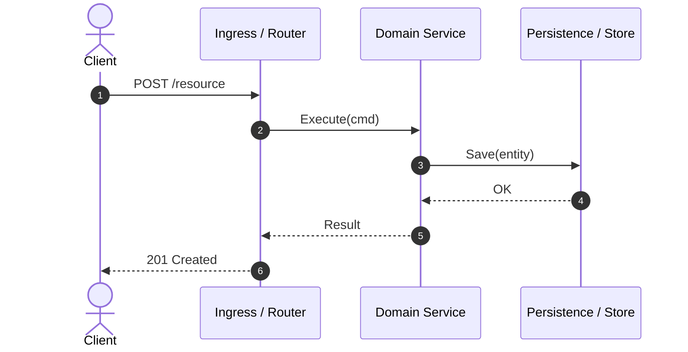

# /explore

Explore an unfamiliar repository and generate a **Guided Cognitive Tour** designed for rapid human comprehension.

Instead of browsing file trees alphabetically, this skill extracts Git forensics, identifies the system's core domain models, traces the request lifecycle, and creates a **curated, step-by-step reading path** (~30–45 min reading budget) as an interactive Markdown Artifact.

## Guiding Principles

- **Cognitive Dependency First**: Never order files alphabetically or by directory nesting. Order files by conceptual prerequisite: Domain Entities & Contracts $\rightarrow$ Storage / State $\rightarrow$ Core Services / Use Cases $\rightarrow$ Entrypoints / HTTP Handlers $\rightarrow$ Living E2E Tests.
- **Spotlight the Beating Heart**: Ruthlessly filter out boilerplate, vendor packages, lockfiles, and generated code. Focus on the 5–10 files that embody the business logic and architectural invariants.
- **Portable Markdown Artifact**: Present the tour as a structured, standalone Markdown document or UI artifact (via the harness's native artifact mechanism, sidecar canvas, or written to a dedicated `TOUR.md`) using standard GitHub-Flavored Markdown (GFM), Mermaid diagrams, and portable file links (`[path#L1-L40](path/to/file#L1-L40)`).

---

## Workflow

### 1. Automated Forensics
Run the automated repo analyzer script to extract tech stack, entrypoints, Git churn hotspots, and candidate models:
```bash
python3 <skill-dir>/scripts/analyze-repo.py .
```
*(Or specify target path: `python3 <skill-dir>/scripts/analyze-repo.py /path/to/repo`)*

### 2. Inspect the Domain Core & Request Flow
Using the output from Step 1:
- Inspect detected entrypoints (`main.go`, `index.ts`, `app.py`) to understand service bootstrap and wiring.
- Inspect 2–3 primary domain models/schemas to identify the central business entities.
- Trace one canonical request/event flow end-to-end (from HTTP/CLI handler $\rightarrow$ service logic $\rightarrow$ persistence/external I/O).

### 3. Generate the Cognitive Tour Document / Artifact
Output the guide using the harness's native artifact mechanism (or write to `TOUR.md` / artifact directory) formatted in standard GitHub-Flavored Markdown with Mermaid:

```markdown
# 🧭 Guided Cognitive Tour: [Repository Name]

## 🎯 Executive Summary
<2-3 sentences: what business problem this solves, architectural pattern (e.g. Hexagonal, Clean, MVC), and runtime topology.>

## 🗺️ Recommended Cognitive Reading Path
*Read in this exact sequence to build a complete mental model without cognitive overload:*

1. [`path/to/entity.ext#L1-L40`](path/to/entity.ext#L1-L40) — **Core Domain Entity**: <Why to read first. Key business invariants and states.>
2. [`path/to/repository.ext#L15-L60`](path/to/repository.ext#L15-L60) — **State & Persistence**: <How state is stored and retrieved.>
3. [`path/to/service.ext#L20-L80`](path/to/service.ext#L20-L80) — **Core Business Logic**: <The primary use case algorithm or rule engine.>
4. [`path/to/handler.ext#L1-L50`](path/to/handler.ext#L1-L50) — **Ingress & Transport**: <How incoming requests are validated and dispatched.>
5. [`path/to/e2e_test.ext#L1-L60`](path/to/e2e_test.ext#L1-L60) — **Living Specification**: <The test demonstrating the happy path end-to-end.>

## ⚡ The Life of a Request


## ⚠️ High-Risk Areas & Hotspots (Git Churn)
- **`path/to/file`**: <Why it's critical, recent commit churn, potential failure modes, concurrency/locks.>

## 🚀 Quickstart & Verification Commands
```bash
<Primary command to run local dev environment or test suite>
```
```

### 4. Next Steps
- Present the artifact link to the developer.
- Offer targeted next steps: e.g. "Would you like me to deep-dive into the state machine in `service.ext`, or explain the authentication flow?"
