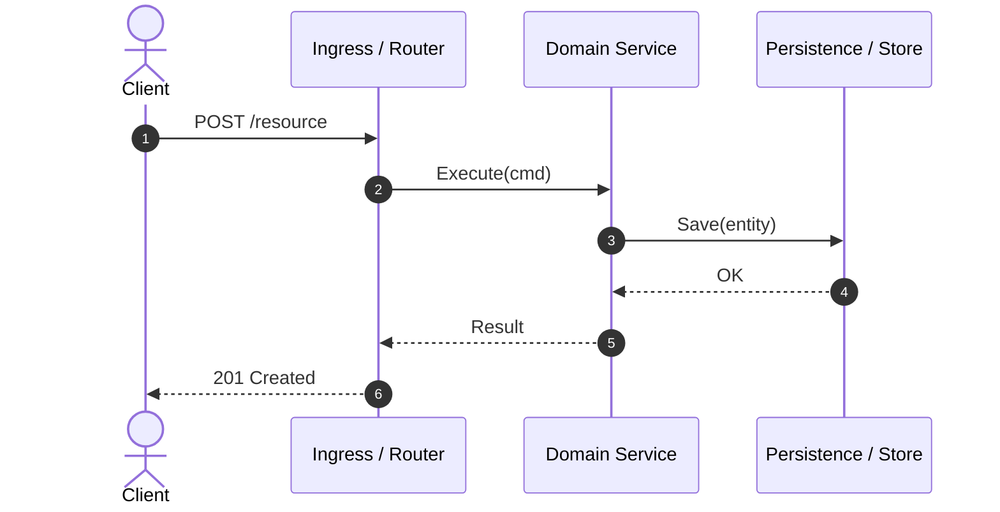

# /explore

Explore an unfamiliar repository and generate a **Guided Cognitive Tour** designed for rapid human comprehension.

Instead of browsing file trees alphabetically, this skill extracts Git forensics, identifies the system's core domain models and event schemas, traces the primary lifecycle (Request-Driven or Event-Driven), and creates a **curated, step-by-step reading path** (~30–45 min reading budget) as a portable Markdown document or artifact.

## Guiding Principles

- **Cognitive Dependency First**: Never order files alphabetically or by directory nesting. Order files by conceptual prerequisite: Domain Entities, Event Schemas & Contracts $\rightarrow$ Storage / State $\rightarrow$ Core Services / Use Cases $\rightarrow$ Entrypoints (HTTP Handlers, Workers, Consumers) $\rightarrow$ Living E2E Tests.
- **Support Diverse Architectures**: Do not assume classic MVC/REST. Explicitly recognize:
  - **Request-Driven**: Ingress $\rightarrow$ Router $\rightarrow$ Use Case $\rightarrow$ Persistence.
  - **Event-Driven & Worker-Driven (EDA)**: Event Schema $\rightarrow$ Producer $\rightarrow$ Consumer/Worker/Subscriber $\rightarrow$ State Mutation.
  - **Hexagonal / Clean**: Core Domain $\rightarrow$ Ports $\rightarrow$ Adapters (HTTP, Message Brokers, DB).
- **Spotlight the Beating Heart**: Ruthlessly filter out boilerplate, vendor packages, lockfiles, and generated code. Focus on the 5–10 files that embody the business logic and architectural invariants.
- **Portable Markdown Artifact**: Present the tour as a structured, standalone Markdown document or UI artifact (via the harness's native artifact mechanism, sidecar canvas, or written to a dedicated `TOUR.md`) using standard GitHub-Flavored Markdown (GFM), Mermaid diagrams, and portable file links (`[path#L1-L40](path/to/file#L1-L40)`).

---

## Workflow

### 1. Automated Forensics
Run the automated repo analyzer script:
```bash
python3 <skill-dir>/scripts/analyze-repo.py .
```

**Advanced options for focused exploration:**
- Focus on a specific subsystem or monorepo package: `python3 <skill-dir>/scripts/analyze-repo.py . --subpath backend`
- Time-bounded commit churn: `python3 <skill-dir>/scripts/analyze-repo.py . --since "3 months ago"`
- Quick human-readable terminal summary: `python3 <skill-dir>/scripts/analyze-repo.py . --format text`

### 2. Inspect the Domain Core & Primary Flow
Using the output from Step 1:
- Inspect detected entrypoints:
  - **HTTP/RPC Servers**: `main.go`, `server.ts`, `app.py`.
  - **Workers & Tasks**: `worker.py`, `tasks.ts`, `jobs.go`.
  - **Event Consumers & Listeners**: `consumers/**/*.go`, `subscribers/**/*.ts`, `listeners/**/*.py`.
- Inspect primary domain entities, event schemas (`events/`, `messages/`, `*.proto`), or DB migrations.
- Trace one canonical lifecycle end-to-end:
  - *If Request-Driven*: Client $\rightarrow$ Handler $\rightarrow$ Service $\rightarrow$ DB.
  - *If Event-Driven*: Event Producer $\rightarrow$ Broker/Queue $\rightarrow$ Consumer/Worker $\rightarrow$ State Store.

### 3. Generate the Cognitive Tour Document / Artifact
Output the guide using the harness's native artifact mechanism (or write to `TOUR.md` / artifact directory) formatted in standard GitHub-Flavored Markdown with Mermaid:

```markdown
# 🧭 Guided Cognitive Tour: [Repository Name]

## 🎯 Executive Summary
<2-3 sentences: what business problem this solves, architectural pattern (e.g. Event-Driven, Hexagonal, Clean, Worker Queue), and runtime topology.>

## 🗺️ Recommended Cognitive Reading Path
*Read in this exact sequence to build a complete mental model without cognitive overload:*

1. [`path/to/entity_or_event.ext#L1-L40`](path/to/entity_or_event.ext#L1-L40) — **Core Domain Entity / Event Contract**: <Why to read first. Key business invariants, states, or payload schema.>
2. [`path/to/repository_or_store.ext#L15-L60`](path/to/repository_or_store.ext#L15-L60) — **State & Persistence**: <How state or stream offsets are persisted.>
3. [`path/to/service_or_worker.ext#L20-L80`](path/to/service_or_worker.ext#L20-L80) — **Core Business Logic / Worker Handler**: <The primary use case algorithm, event processing, or rule engine.>
4. [`path/to/ingress_or_consumer.ext#L1-L50`](path/to/ingress_or_consumer.ext#L1-L50) — **Ingress / Event Consumer**: <How incoming HTTP requests or queue messages are ingested and dispatched.>
5. [`path/to/e2e_test.ext#L1-L60`](path/to/e2e_test.ext#L1-L60) — **Living Specification**: <The test demonstrating the happy path end-to-end.>

## ⚡ The Life of a [Request / Event]


## ⚠️ High-Risk Areas & Hotspots (Git Churn)
- **`component/or/file`**: <Why it's critical, recent commit churn, potential failure modes, concurrency/locks, or distributed consistency.>

## 🚀 Quickstart & Verification Commands
```bash
<Primary command to run local dev environment, workers, or test suite>
```
```

### 4. Next Steps
- Present the artifact link to the developer.
- Offer targeted next steps: e.g. "Would you like me to deep-dive into the Kafka consumer error handling, or inspect the state transitions in `worker.py`?"
